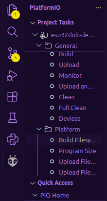

# WeaStat
### Is probably what im going to call it ignore the repo name 
Dear reviewers, current readme is prototype. When I build the project irl most photos will be replaced, instructions may become more specific/helpful, and this message will be removed.

## Premise
A pcb with an eink display that shows outside temperatures with a free weather api, and shows inside temperatures with a bme280. All powered with a 18650 battery, attempting to minimize battery drain.

Made by me, for Hack Club Half Life

## BOM

[BOM.csv](https://github.com/NestOfGhosts/EInk-Weather-Display/blob/main/BOM.csv) is only a table of items I personally needed to purchase, not including things I already have. Below is the proper list of materials

|Thing You Need|Details|
|---|---|
|Soldering Equipment|and the expertise to use it. All soldering done for this project should only be through hole|
|Esp32|The Pcb is assuming a DOIT ESP32 DEVKIT V1, and im using a clone|
|18650 Battery & Battery holder|Only necessary if you plan on using a battery to power it. You can use the usb port to power it instead. *More details abt holder below|
|Eink Display|Pcb is assuming a WeAct 2.9"|
|BME280|Pcb is assuming a 6 pin bme, but you could get away with a 4 pin, utilizing the 4 leftmost holes|
|Any 2 buttons|Pcb is assuming a 5 pin mx cherry compatible keyboard switch|

*If you want to use a battery, either use a normal battery holder and an 1N4007 diode to slightly lower the voltage(needed bc full battery outputs more than 3.6v), or a dedicated module that controls 3v3 output ([example](https://www.aliexpress.com/item/1005006351276180.html?spm=a2g0o.detail.0.0.2164unO6unO65w&mp=1&pdp_npi=6%40dis%21CAD%21CAD+4.67%21CAD+4.67%21%21CAD+4.67%21%21%21%4021030f8317938421479141980e0f47%2112000046129008872%21ct%21CA%216330886401%21%211%210%21)). Alternatively, you can use another battery source that consistantly outputs ~3.3v

If you have different parts than the pcb assumes, you can edit the [.kicad_pcb file](https://github.com/NestOfGhosts/EInk-Weather-Display/blob/main/Pcb%20Files/weatstat.kicad_pcb) in KiCad with the footprints of your actual parts.

## Build Steps

### (Optional) Holder

Print holder from [Holder Files](https://github.com/NestOfGhosts/EInk-Weather-Display/tree/main/Holder%20Files) (FCStd is an editable cad file, for freecad. If you want to edit the source you have to use freecad) (STL for 3d printing)

### Firmware
#### Instructions for windows. Figure out equivalent actions for other OSs, and do them :)
1. Download Visual Studio Code, and in VSCode's extensions sidebar install Platformio.
2. Clone the Firmware Files folder, and open it in VSCode (make sure to trust the workspace)
3. Set the esp32 to bootloader mode by resetting it and setting GPIO0 to LOW (grounding gpio0). You may also use any "boot" buttons if your esp32 has it.
4. (Optional) Open "Device Manager" (In windows)

- Expand the "Ports (COM & LPT)" section

- Plug in the esp  

- Take note of any new devices  

5. Click the house button at the bottom. Open the Firmware Files folder from earlier. Then, (with your board plugged in), click on the alien on the sidebar. Click "Build Filesystem", wait for finish, then click upload filesystem image.

6. Wait for it to finish. Finally, click the checkmark at the bottom, then when it completes press the right arrow.

Wow ur done flashing.

### Soldering
#### Hopefully you have a fume extractor
#### Schematic [here](https://github.com/NestOfGhosts/EInk-Weather-Display/blob/main/Pcb%20Files/shematic.pdf). U1 is esp, J2 is display, J3 is the BME, the switches are the buttons, and the battery is the battery (technically the holder but whtever)
1. Solder ESP to backside
2. Rest of things to frontside.
- The battery holder doesnt have a spot on the pcb, but the holder has a bit of extra space for it so if you're using the holder you can just kinda pit it next to it
- In terms of soldering, solder the battery holder's 3v3 output to 3v3, and the gnd to gnd. If you're using a basic battery holder put the diode in between the plus side and the esp, with the direction allowing power to flow from the battery to the ESP.
### Use
Make sure there's power
- Press both buttons at the same time to turn on config mode
- Use a device to connect to the new hotspot that is created by the esp. Named "E-Ink Weather"
- While connected to the hotspot, go on a browser and go to 192.168.4.1
- You can now change location (In WGS84 coordinates. Look them up with a maps app, if you're not sure if its WGS84 use a converter), and what each screen looks like.
### Customizability 
- Code customized by copying the firmware folder (INSERT LINK TO FOLDER), opening in [VS Code](https://code.visualstudio.com/download), and using platformio to compile/build.
- Case customized with [.FCStd](https://github.com/NestOfGhosts/EInk-Weather-Display/blob/main/Holder%20Files/halvedLife.FCStd) or [.step](https://github.com/NestOfGhosts/EInk-Weather-Display/blob/main/Holder%20Files/halvedLife-Body.step)
- Pcb customized using [kicad_pcb](https://github.com/NestOfGhosts/EInk-Weather-Display/blob/main/Pcb%20Files/weatstat.kicad_pcb) (using kicad obv)
- 
